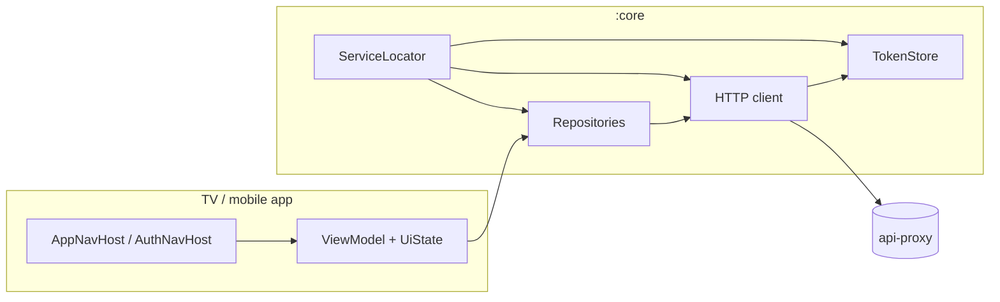

# Stoganet Android Client

Android apps for Stoganet. They talk only to [api-proxy](https://github.com/Stoganet/api-proxy), never directly to Jellyfin.

## TV app

- Sign in with username and password or Jellyfin Quick Connect
- Home with the focused item's backdrop, title and overview above rows of recently added and all movies and shows
- Movie and TV show libraries
- Detail screen with seasons, episodes and cast, plus Play and Resume
- Player with subtitles and resume position
- Search, and requesting titles that aren't in the library yet

## Modules

- **`:core`**: data layer shared by both apps. Repositories, token storage, the HTTP client and the generated API client.
- **`:tv`** (`com.stoganet.tv`): Android TV app.
- **`:mobile`** (`com.stoganet.mobile`): phone and tablet app.

`:tv` and `:mobile` are separate apps with their own `applicationId` and manifest. `:tv` requires the Leanback launcher and the `android.software.leanback` feature. Neither depends on the other.

## Architecture



**One HTTP client, one base URL.** The client attaches the access token from `TokenStore` and handles 401 → refresh → retry. The refresh request is marked so that a 401 on the refresh itself doesn't trigger another refresh. The TV app reuses the same client for image loading.

**Tokens** are stored encrypted on the device and only accessed through `TokenStore`.

**Two NavHosts in `:tv`.** `AuthNavHost` is shown without valid tokens, and `AppNavHost` after sign-in. `MainActivity` picks one based on `TokenStore`.

## API client

Generated from `openapi/openapi.yaml`, a copy of the spec in `api-proxy`, into `:core` under `com.stoganet.core.api`. After updating the spec, run `./gradlew :core:openApiGenerate`. The output goes to `core/build/generated/openapi/` and is never edited by hand.

## Build and run

```bash
./gradlew :tv:installDebug                  # install the TV app on a connected device or emulator
./gradlew :mobile:installDebug              # install the mobile app
./gradlew :core:testDebugUnitTest :tv:testDebugUnitTest   # unit tests
./gradlew detekt                            # lint
./gradlew detekt --auto-correct             # lint and auto-fix
./gradlew :core:openApiGenerate             # regenerate the API client
./gradlew :tv:assembleRelease               # release APK (needs a signing config)
```

Run a single test class:

```bash
./gradlew :tv:testDebugUnitTest --tests "com.stoganet.tv.ui.auth.QuickConnectViewModelTest"
```

## API base URL

- **Release builds:** `https://api.stoganet.com/`
- **Debug builds:** the `apiBaseUrl` Gradle property, then the `API_BASE_URL` environment variable, then `http://10.0.2.2:8080/` (an api-proxy running on the emulator's host machine)

To point Android Studio debug builds at production, set `apiBaseUrl=https://api.stoganet.com/` in `~/.gradle/gradle.properties`.

Debug builds also append `.debug` to the `applicationId`, so they install next to a release build, and they log HTTP requests.

## Repository layout

| Path | What's there |
|------|-------------|
| `openapi/openapi.yaml` | API spec copied from `api-proxy` |
| `core/src/main/kotlin/.../data/` | `TokenStore`, HTTP client, repositories |
| `core/src/main/kotlin/.../di/` | `ServiceLocator`, the manual dependency wiring shared by both apps |
| `core/src/main/proto/` | Schema for the encrypted token storage |
| `core/consumer-rules.pro` | R8 keep rules for `:core`, merged into both apps automatically |
| `tv/src/main/kotlin/.../ui/` | NavHosts, screens, ViewModels, UiState and Intent types |
| `tv/src/main/res/` | Strings, drawables, TV banner |
| `mobile/src/main/kotlin/.../` | Mobile app |

## License

[MIT](./LICENSE)
